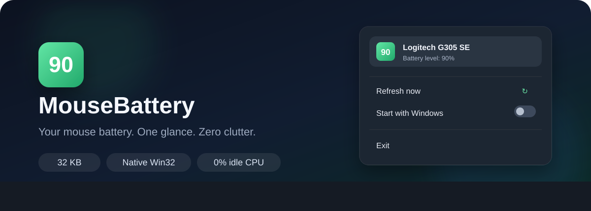

<div align="center">



# MouseBattery

**A tiny native Windows tray indicator for your wireless mouse.**  
See the battery percentage at a glance — no window, installer, account, or vendor suite.

[](#requirements)
[](#why-mousebattery)
[](src/mouse_battery.c)
[](LICENSE)

### [Download MouseBattery.exe](../../releases/latest)

</div>

## Why MouseBattery?

- **The percentage is the icon.** No need to open G HUB or Windows Settings.
- **Extremely small.** A single 32 KB native Win32 executable with no runtime or installer.
- **Almost zero idle cost.** Event-driven UI, no background worker threads, and one battery query every five minutes.
- **Portable.** Put the executable anywhere and run it.
- **Private.** No network access, telemetry, analytics, or accounts.
- **Read-only.** It sends battery queries but never changes mouse settings.

## Supported devices

| Device / connection | Status |
|---|---|
| Logitech G305 SE through LIGHTSPEED receiver `046D:C53F` | ✅ Tested on real hardware |
| Logitech HID++ 2.0 through supported LIGHTSPEED, Unifying, and Bolt receivers | 🟡 Implemented, reports welcome |
| Bluetooth mice that expose `System.Devices.BatteryLife` to Windows | 🟡 Supported through the Windows device property |

Supported Logitech receiver PIDs are listed in [`src/mouse_battery.c`](src/mouse_battery.c).
Hardware support depends on the receiver and mouse firmware exposing a battery feature.

## Install

1. Download `MouseBattery.exe` from the [latest release](../../releases/latest).
2. Run it. There is no installer.
3. Windows 11 may place the new icon behind the **^** tray arrow. Drag the green percentage icon onto the taskbar to keep it visible.
4. Click the icon for **Refresh now**, **Start with Windows**, and **Exit**.

The binary is not code-signed, so SmartScreen can show an *Unknown publisher* warning on first launch.
Use **More info → Run anyway** after verifying the release checksum.

## Icon colors

| Color | Meaning |
|---|---|
| Green | Normal battery level |
| Amber | 16–35% |
| Red | 15% or lower |
| Gray | Mouse unavailable or asleep |

## Requirements

- 64-bit Windows 10 or Windows 11
- A supported mouse or a Bluetooth mouse whose battery level is visible to Windows

## Build from source

Install [Zig 0.15.2](https://ziglang.org/download/) and run:

```powershell
./build.ps1
```

The release binary is written to `dist/MouseBattery.exe`. GitHub Actions runs the same build on every push and pull request.

## Resource use

Measured on the original test system with a Logitech G305 SE:

- executable: **32 KB**;
- private memory: approximately **1.9 MB**;
- Task Manager working memory after startup: approximately **1.3 MB**;
- idle CPU: **0%**;
- polling interval: **5 minutes**.

Shared Windows DLL pages can make process-memory numbers vary between systems.

## Privacy and safety

MouseBattery does not connect to the internet or collect any data. It reads Windows device properties and, for supported Logitech receivers, sends HID++ battery queries. The only persistent system change is the optional `MouseBattery` value under:

```text
HKCU\Software\Microsoft\Windows\CurrentVersion\Run
```

That value is created only when **Start with Windows** is enabled from the tray menu.

## Credits

The Logitech HID++ protocol is documented by the open-source community, especially [Solaar](https://github.com/pwr-Solaar/Solaar). The compact receiver/battery approach was also informed by [peripheral-battery-tray](https://github.com/SteveWang92/peripheral-battery-tray). See [THIRD_PARTY_NOTICES.md](THIRD_PARTY_NOTICES.md).

This is an independent project and is not affiliated with or endorsed by Logitech. Logitech, LIGHTSPEED, Unifying, and Bolt are trademarks of Logitech.

## License

[MIT](LICENSE)
